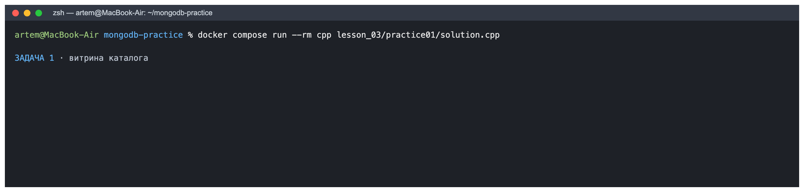
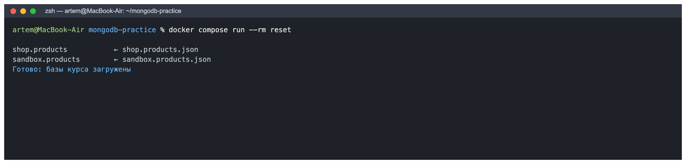
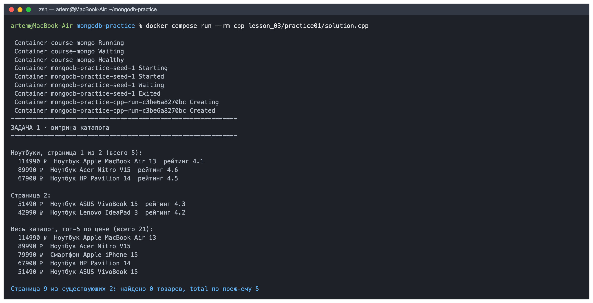
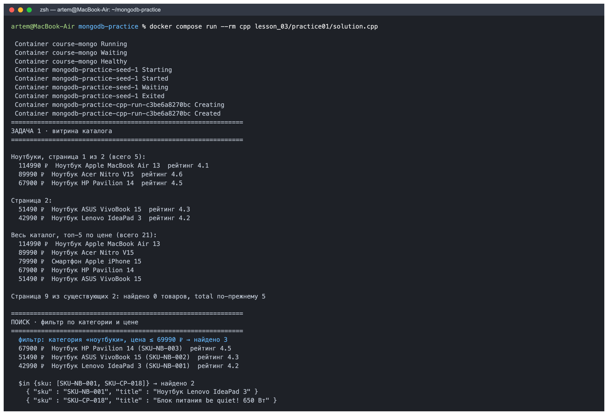
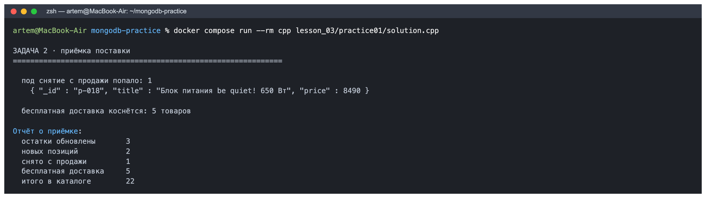
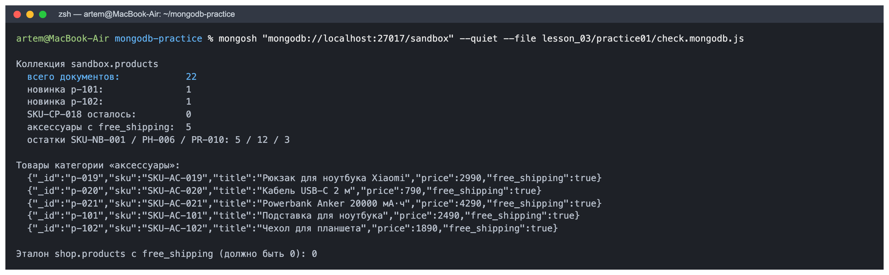

# Домашнее задание № 3 · «Каталог товаров»

**ФИО:** ...
**Группа:** ...
**Дата:** 29.10.2026

## Задание

Практическая работа из справочника:
<https://maximbytecamp.github.io/mongodb_theory_makarov/praktiki/01-katalog-tovarov/index.html>

Работа выполнена в своей копии `data-platform-template`. Решение практики
лежит в [`practice01/`](practice01/): `solution.cpp` — программа каталога,
`check.mongodb.js` — проверка результата в `sandbox`.

## Среда выполнения

- ОС: macOS (Apple Silicon), терминал zsh;
- язык и версия: C++17, g++ 12.2.0, драйвер MongoDB C++ (mongocxx 4.5.3);
- MongoDB / Compass: MongoDB 7 (контейнер `course-mongo` через Docker Desktop / OrbStack);
- база данных: `shop` — каталог только для чтения (21 товар), `sandbox` — её копия, в которой выполняются правки;
- коллекция: `products` (обе базы);
- выбранный вариант запуска: **через Docker** (`docker compose run --rm cpp ...`), потому что платформенный `mongo-cxx-driver` под macOS ставится дольше и требует Homebrew;
- команда запуска:

  ```bash
  cd mongodb-practice                       # репозиторий практик, стенд в compose.yaml
  docker compose up -d                      # сервер MongoDB 7 на localhost:27017 + заливка данных
  docker compose run --rm reset             # чистые данные перед прогоном
  docker compose run --rm cpp lesson_03/practice01/solution.cpp
  docker compose run --rm python practice01/check.py     # самопроверка: Пройдено 12 из 12
  ```

## Результаты

### Что создано и загружено

Базовые данные залиты командой `docker compose run --rm reset`: в `shop.products`
и `sandbox.products` по 21 товару (ноутбуки, смартфоны, планшеты, аксессуары и т. д.).
Программа дополнительно **создаёт две новые позиции** в `sandbox` через `insert_many`:

| `_id` | `sku` | Название | Категория | Цена |
|---|---|---|---|---|
| `p-101` | `SKU-AC-101` | Подставка для ноутбука | аксессуары | 2490 |
| `p-102` | `SKU-AC-102` | Чехол для планшета | аксессуары | 1890 |

У новинок задан свой `_id`, поэтому повторный запуск упирается в `E11000`
и печатает «2 позиций уже были в каталоге — пропущены» — дублей не появляется.

### Какие операции выполнены

**Задача 1 — витрина каталога.** Функция `catalog_page(category, page, per_page, sort_field, desc)`
возвращает `(items, total)`:

- фильтр собирается по условию — категория необязательна;
- проекция `{_id: 0, sku: 1, title: 1, price: 1, rating: 1}`;
- сортировка по двум ключам `{price: -1, sku: 1}`, чтобы порядок был однозначным;
- страницы через `skip`/`limit`, `total` считается на сервере через `count_documents`.

Получилось: ноутбуков — **5**, страниц по 3 — **2**; топ-5 всего каталога
начинается с «Ноутбук Apple MacBook Air 13 — 114990 ₽»; запрос девятой страницы
вернул **0 товаров**, при этом `total` по-прежнему 5 (пустая страница — не ошибка).

**Поиск/фильтрация.** Фильтр «категория *ноутбуки* и цена ≤ 69990 ₽»,
сортировка по цене: найдено **3** товара —

- 67900 ₽ Ноутбук HP Pavilion 14 (`SKU-NB-003`), рейтинг 4.5
- 51490 ₽ Ноутбук ASUS VivoBook 15 (`SKU-NB-002`), рейтинг 4.3
- 42990 ₽ Ноутбук Lenovo IdeaPad 3 (`SKU-NB-001`), рейтинг 4.2

Проверен и `$in`: `{sku: {$in: ["SKU-NB-001", "SKU-CP-018"]}}` → 2 товара.

**Задача 2 — приёмка поставки** (в `sandbox`):

| Шаг | Операция | Результат |
|---|---|---|
| остатки `SKU-NB-001` / `SKU-PH-006` / `SKU-PR-010` | `$inc` (`update_one`) | обновлено 3 |
| новые позиции `p-101`, `p-102` | `insert_many` (`ordered=false`) | 2 |
| снятие с продажи `SKU-CP-018` | `count_documents` → `find` (просмотр) → `delete_many` | удалено 1 |
| бесплатная доставка аксессуарам | `update_many` `$set: {free_shipping: true}` | изменено 5 |
| итого в каталоге `sandbox` | `count_documents` | 22 |

Перед удалением программа показывает, что попадёт под него:
`{ "_id" : "p-018", "title" : "Блок питания be quiet! 650 Вт", "price" : 8490 }`.

**Проверка в базе** (`check.mongodb.js` через `mongosh`): 22 документа,
остатки 5 / 12 / 3, у 5 аксессуаров `free_shipping: true`, документов
`SKU-CP-018` — 0, в эталонной `shop.products` поля `free_shipping` нет ни у
одного документа (0) — правки не ушли в чужую базу. Самопроверка практики
`check.py` — **Пройдено 12 из 12**.

## Скриншоты

1. Запуск: 
2. Создание товаров: 
3. Каталог: 
4. Поиск: 
5. Изменение/удаление: 
6. Проверка в базе: 

Кадры 01 и 05 сделаны в терминале: `docker compose run --rm cpp lesson_03/practice01/solution.cpp`.
Кадр 02 — заливка чистых данных `docker compose run --rm reset`.
Кадр 06 — `mongosh "mongodb://localhost:27017/sandbox" --quiet --file lesson_03/practice01/check.mongodb.js`.

## Ответы на вопросы

**1. Какие поля есть у документа товара? Какие поля должны иметь числовой тип и почему цену и количество нельзя хранить строками?**

Документ товара в `shop.products` содержит: `_id` (строка `p-001`…), `sku`, `title`,
`brand`, `category`, `price` (число), `specs` (массив строк), `stock` (массив объектов
`{warehouse, qty}`), `rating` (дробное число), `reviews` (число), `added` (дата `ISODate`);
в `sandbox` после приёмки появляются ещё `qty_total` (число) и `free_shipping` (логическое).
Числовыми должны быть `price`, `qty`/`qty_total`, `rating`, `reviews`: BSON хранит тип вместе
со значением, и для строк MongoDB сравнивает их лексикографически — `"90" > "100000"`
истинно, поэтому фильтр `{price: {$gt: 55000}}` строки не находит (на занятии 1
запрос `{salary: {$gt: "100000"}}` вернул 0), `$inc` по строке выдаёт ошибку, а `$sum`
и сортировка по строковой цене дают неверный порядок. Кроме того, в строке нельзя хранить
денежную точность без отдельного правила: для денег в BSON есть `Decimal128`.

**2. Чем обычное чтение коллекции отличается от поиска по условию? Приведите пример.**

Обычное чтение `find({})` без фильтра возвращает все документы коллекции в порядке хранения
(или в порядке индекса) — это полный обход каталога. Поиск добавляет фильтр, и сервер отдаёт
только документы, которые ему удовлетворяют; проекция ещё и обрезает поля, а `sort`/`skip`/`limit`
превращают выборку в страницу. В моём коде чтение всей коллекции — `products.count_documents({})`,
а поиск — вот такой:

```cpp
auto query = make_document(kvp("category", "ноутбуки"),
                           kvp("price", make_document(kvp("$lte", 69990))));
options.projection(make_document(kvp("_id", 0), kvp("sku", 1), kvp("title", 1)));
options.sort(make_document(kvp("price", -1), kvp("sku", 1)));
for (auto&& doc : products.find(query.view(), options)) { ... }
```

Этот поиск вернул 3 товара из 21: категория «ноутбуки» и цена не выше 69990 ₽.
Фильтр — обычный BSON-документ, поэтому его можно собрать по частям, не склеивая строк.

**3. Как вы проверили, что операция действительно изменила данные в MongoDB, а не только текст в интерфейсе программы?**

Во-первых, программа печатает не свои догадки, а числа, которые вернул сервер:
`modified_count`, `deleted_count`, `inserted_count`, `matched_count` — они приходят в ответе
на саму операцию записи. Во-вторых, после работы отдельным подключением `mongosh`
в базу `sandbox` я выполнил `check.mongodb.js` и вижу там 22 документа, остатки 5 / 12 / 3,
`free_shipping: true` у 5 аксессуаров, отсутствие `SKU-CP-018` и отсутствие правок в
эталонной `shop` (0). В-третьих, независимая самопроверка практики `check.py` читает только
базу и выдала «Пройдено 12 из 12». Наконец, повторный запуск программы показал
«2 позиций уже были в каталоге — пропущены», то есть данные действительно сохранились
между запусками, а не жили в памяти программы.

## Вывод

Я научился(ась) писать функции витрины каталога с фильтром, проекцией, сортировкой по
двум ключам и постраничной выдачей, считать `total` на сервере и безопасно выполнять
изменения — `$inc` для остатков и снятие с продажи с предварительным просмотром.
Программа запускается повторно без ошибки подключения и не создаёт дублей благодаря
заданным `_id`. В MongoDB через `mongosh` и `check.py` проверено, что все четыре операции
приёмки действительно изменили `sandbox` (22 позиции, остатки 5 / 12 / 3, 5 аксессуаров
с бесплатной доставкой, `SKU-CP-018` удалён), а эталонная база `shop` осталась нетронутой.
